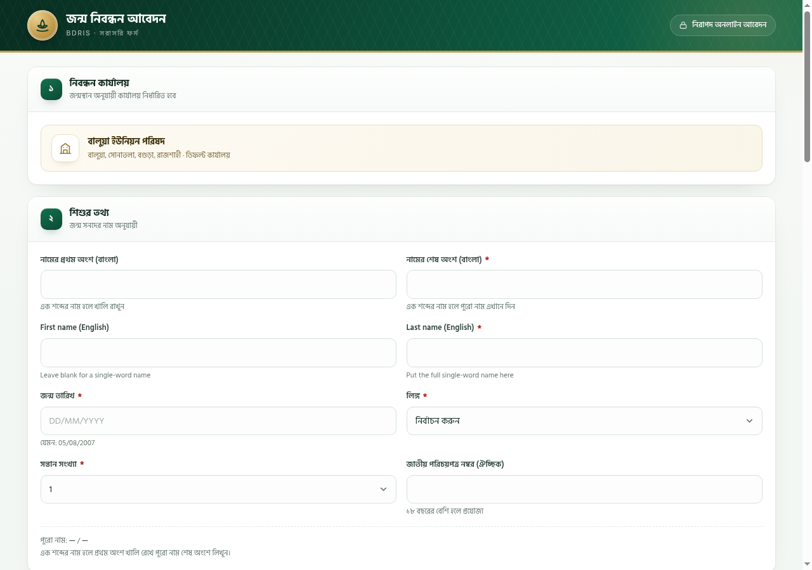
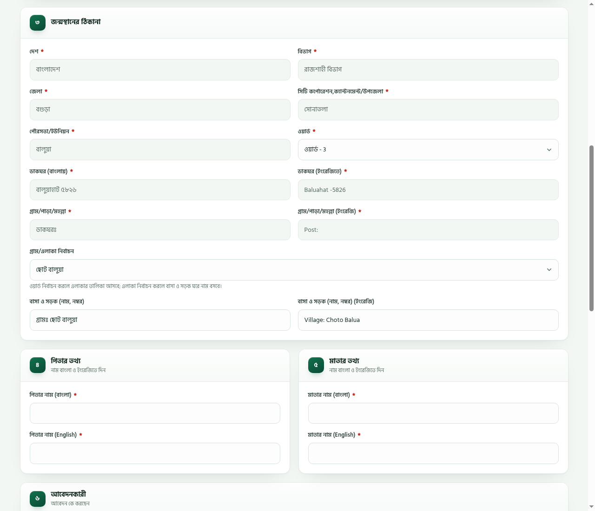
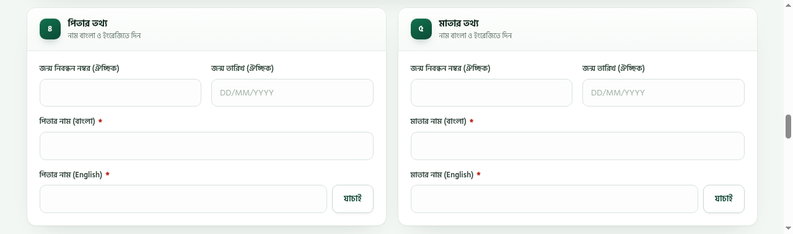
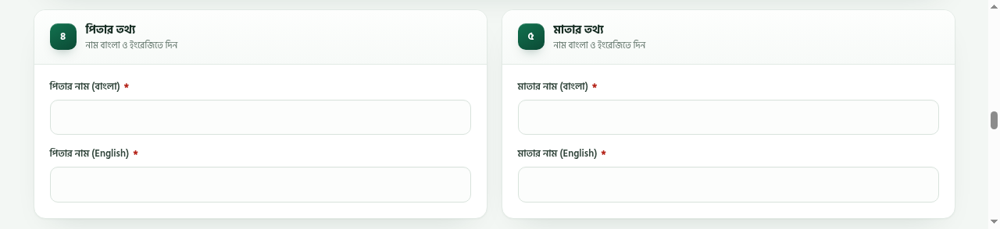

# BDRIS Birth Registration Form

A standalone PHP form for submitting birth registration applications to the BDRIS portal.

## Features

- Bengali single-page form with a live Bengali/English name preview
- Birth-place address chain preconfigured for Balua Union (Rajshahi → Bogura → Sonatola → Balua)
- Ward 1–9 selector and a ward-filtered voter-area dropdown that fills the house/road fields
- Parent UBRN/DOB fields and verify buttons shown only when the child's DOB is 01/01/2013 or later
- Attachment type detection by date of birth and file upload
- OTP send and verify flow
- Applicant section prefilled for the OTHERS relation
- Local success page with the full application summary and print/PDF action
- No database; state and cookies are stored in a per-session cache directory

## Screenshots

### Child details



### Birth-place address and voter area



### Parent information (child DOB 01/01/2013 or later)



### Parent information (child DOB before 01/01/2013)



## Requirements

- PHP 8.1 or newer
- PHP extensions: `curl`, `mbstring`, `json`, `session`
- A writable cache directory

## Setup

1. Copy `form.php` to a web-accessible directory.
2. Create the cache directory next to `form.php`:

   ```sh
   mkdir -p cache/ff
   chmod 700 cache cache/ff
   ```

3. Serve `form.php` directly with PHP-FPM, Apache, Nginx, or the PHP built-in server:

   ```sh
   php -S 127.0.0.1:8099
   ```

4. Open `http://127.0.0.1:8099/form.php`.

The defaults at the top of `form.php` can be changed:

```php
define('FF_UP', 'https://bdris.gov.bd');
define('FF_TTL', 1500);
define('FF_CACHE', __DIR__ . '/cache/');
```

## Usage

1. Fill in the child's details. The parent UBRN/DOB fields appear only for a child born on or after 01/01/2013.
2. Select a ward (1–9), then choose a voter area; the house/road fields fill with the area name and remain editable.
3. Complete the parent names and review the prefilled applicant details.
4. Upload the required attachments.
5. Send and verify the mobile OTP.
6. Submit the application.
7. Save or print the local acknowledgement page.

## Single-word names

BDRIS splits the child's name into first and last parts. For a one-word name, leave the first-name field empty and put the full name in the last-name field. The form joins the parts with a space, so the submitted full name stays exactly the one word.

For a multi-word name, put everything except the last word in the first-name field and the last word in the last-name field. Example: `মোছাঃ সুরাইয়া আকতার` → first part `মোছাঃ সুরাইয়া`, last part `আকতার`.

Father and mother names are entered as a single full name in each language.

## Notes

- The form is preconfigured for Balua Union; the division, district, upazila, union and post office fields are fixed.
- Ward numbers and voter-area names are stored in `form.php`.
- The cache directory stores session state and upstream cookies. Keep it outside the public web root or deny direct HTTP access to it.
- Serve the form over HTTPS in production.
- This project is not affiliated with BDRIS.
